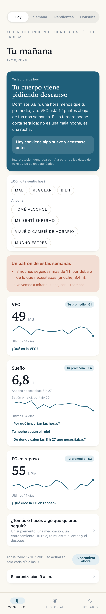
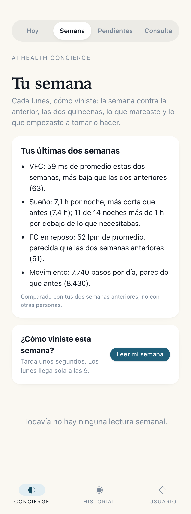
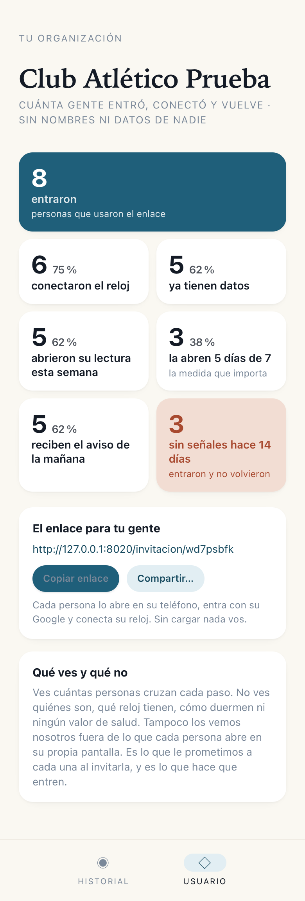
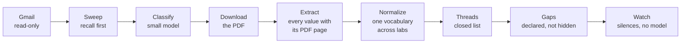

# AI Longevity for Teams

**A B2B preventive health benefit that companies buy for their teams. The Wellhub (ex-Gympass) of longevity.**

Idea stage, with a working demo in private beta: [salud-healthtech.vercel.app/en](https://salud-healthtech.vercel.app/en). The code is private; this page explains what it does and how it is built.

## The three parts

1. **A longitudinal health record.** It connects to the user's Gmail (read-only), finds the lab results, imaging reports and medical records they already received over the years, and organizes them by what happened to the body (a body part, an analyte, a type of study) instead of a list by date.
2. **Wearables.** Garmin today, Oura and Whoop next.
3. **An AI health concierge.** A daily reading of the wearable every morning, a weekly summary on Mondays, and pattern alerts on rest, load and recovery. Next: reading lab results and wearable data together.

On top, an **organization layer** for the employer: one invite link per company or gym, and an aggregate dashboard with no names and no values.

  
  
  

## How the record is built: a pipeline, not an agent

Each stage is deterministic code or a single model call. Nothing loops, nothing improvises.

- **Sweep** goes for recall, not precision: a false positive dies in the classifier for a fraction of a cent, a missed report is lost for good.
- **Extract** is the expensive stage and the only one that can do real harm, so it has the strictest rules (below).
- **Normalize** makes two labs comparable, so five years of one value fit in one chart.
- **Gaps** keep the promise that matters: not "all your reports are here", which is impossible, but "nothing goes missing in silence".
- **Watch** flags threads that have gone too long without a new record, with explicit rules and zero model calls.

## Rules enforced in code

- **No lab value without the page it came from.** A value without a PDF page is not stored and not shown. A hallucinated value is real harm, not a UI bug.
- **Facts and silences, never prescriptions.** "There's been no study here in 26 months" is fine. "You should get X" is not.
- **A closed list of threads, curated by hand.** The model picks from it; it never invents categories.
- **The cheap filter always runs before the model.** No model call over unfiltered volume.
- **Privacy by code, not by discipline.** Gmail access is read-only. Email bodies and lab values never reach the logs: a guard breaks the log instead of letting them through. Tokens are encrypted at rest, with the key kept apart from the database.

## Stack

Python · FastAPI · PostgreSQL · Redis + RQ · Railway · Claude API (a small model to classify, a larger one to extract and to write the readings) · Gmail API · Web Push · landing on Vercel

## Built by

[Bautista Garzón](https://www.linkedin.com/in/bautistagarzon/), solo, in 2026.
